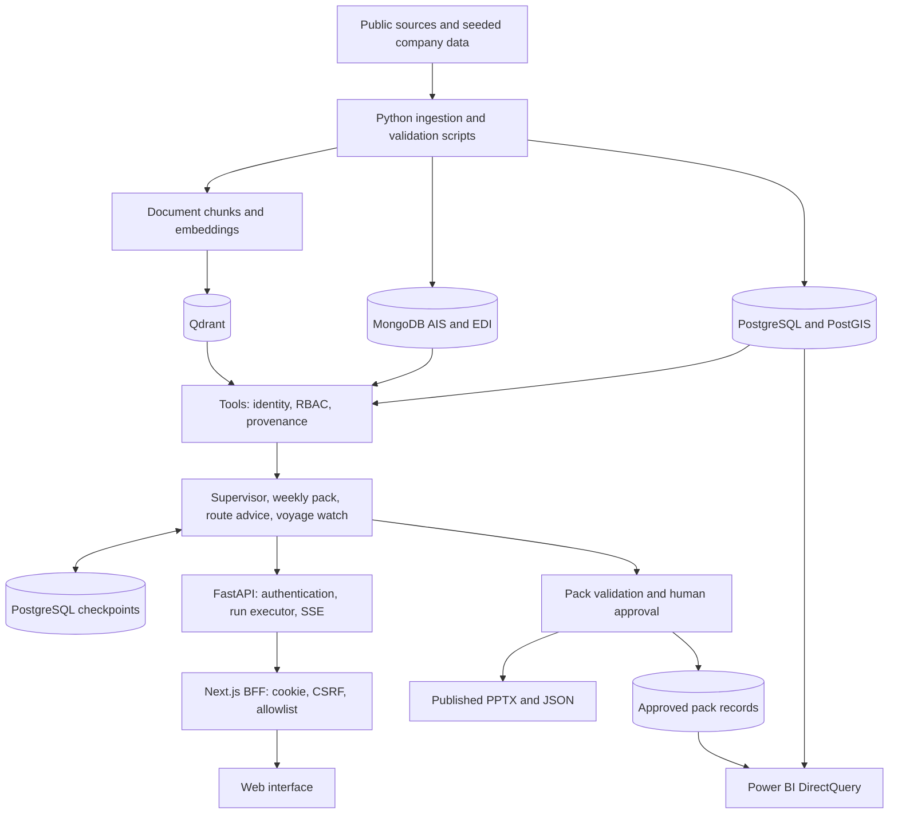

# PortPilot engineering review and continuation plan

**Review date:** 2026-11-10 (Africa/Cairo). **Implementation status: APPROVED (2026-11-10), in progress.**

The initial review was completed within the verification scope below before application fixes began. The
Progress / deviations section records the approved implementation since then. This plan complements the existing
Frontend and Traffic billing link plans; it does not supersede their accepted owner decisions.

## Assessment

PortPilot (formerly NileGate) is a substantial integrated local demonstration, with strong data provenance, governed tools,
deterministic financial calculations, human approval, and useful evaluation infrastructure. Its main remaining
engineering work is reliability and acceptance closure. Expanding the product now would increase the number of
paths that depend on unresolved execution and approval behavior.

Preserve the existing architecture. Fix the confirmed runtime defects, make integration checks independent of
the owner's application state, close the two active feature plans, and establish a reproducible baseline before
adding JIT arrival advice. Optimization should follow measured latency, quota use, and resource pressure.

## System and build flow

The historical construction sequence is data ingestion and schema controls → document retrieval → finance
views and Power BI → finance pack and evaluation → operations products and supervisor → scheduling and
observability → API and memory → approval enhancements → web UI and external context → traffic link.

| Area | Current implementation and development flow |
|---|---|
| Python | Python 3.13; dependency manifest and `uv.lock`; `uv sync --frozen`, then scripts from the project root. The installed environment was used without synchronization for this review. |
| Data | Owning scripts create/verify processed artifacts. PostgreSQL changes use numbered migrations; database snapshots and read-only audits record the applied state. MongoDB and Qdrant have separate setup/load procedures. |
| Finance | SQL views are the KPI authority; tools, charts, and Power BI consume them. Money is SDR. Reports replay 2025 weeks. |
| Operations | Sea routes, tariff/fuel costs, rule-based ETA, and alerts are computed by code. The operational replay is capped at 2026-09-13. Weather is context, not a correction to the synthetic vessel speed. |
| Models | Provider calls, cache, quota reservations, fallback, and structured output are centralized. Models explain/select; number slots and code validation constrain numerical output. |
| API | `Serve.py` starts one loopback process. Persistent graph state is in PostgreSQL; run buffers and conversation uploads are process-local. |
| Web | Node 24, `npm ci`, generated API/Zod contracts, TypeScript/ESLint/Prettier, production build and Playwright. Browser requests go through the BFF. |
| Runtime | Three database containers; API and scheduled CLIs on Windows; Compose packages the web service only. This scope is intentional. |
| CI | Python lint/type checks, monitoring/mirror offline checks, OpenAPI and approval fixtures; separate web static/build/browser job using a mock API. The Python runtime integration suite is not in CI. |

## Actual stopping point

Use the latest progress entries plus code/artifacts, rather than the introductory summaries of older documents.

| Track | Evidence-supported state | Next required step |
|---|---|---|
| Data, RAG, agents, API, memory, approval enhancements | Implemented, with historical acceptance records. Recent code changes are ahead of the last commit. | Revalidate affected behavior after the fixes below. Historical passing results do not certify the current tree. |
| External context | Closed 2026-11-09; `stage1_eval_2026-11-08_ec2.json` exists. | Keep the accepted behavior as a regression baseline. |
| Traffic billing link | Latest handoff says **Phases 1–5 done**, including `traffic_link`, `context.link`, slide 9, and V10. Source confirms these additions. | **Phase 6:** packs twice, full EN/AR Q&A twice, one live pack, then closure. Fix R5/R6 before spending quota on acceptance. |
| Frontend | F0–F7 implementation recorded. Current production-build browser suite passes **93 tests; 49 intentionally skipped**. | Real-model EN/AR follow-ups, a view and route question; real UI pack change/decision; Power BI comparison; pushed CI; archive/commit. |
| Weekly pack | Latest published local folder is W15, whose `run.json` records approval on 2026-11-07. W16 attempts 3 and 4 have preview files. W16 attempt 1 ended `output_invalid` on 2026-11-09 at 10:30 Cairo. | The recorded handoff says reject W16:3 and review W16:4. Verify current checkpoint state before any action; no W16 approval was performed in this review. |
| Voyage watch | The latest scheduler log, 2026-11-10 at 10:30 Cairo, reports the replay complete, 15 retained runs, exit 0. | Treat these as completed replay results. They are not a live AIS monitoring feed. |
| JIT arrival | PROPOSED only. J1–J7 remain decisions in its plan. | Keep queued until reliability and current acceptance are closed. |
| Database evidence | Snapshot contains `external` and `finance_scenario`, but no `CREATE VIEW ... kpi_traffic_link` and no migration-028 column comments. | Refresh snapshot and full audit through 028. Applied status is documented; live DB state was not queried in this review. |
| Git | Branch `feat/agents`, HEAD `0ebe25a` (2026-11-03). At inventory: **64 modified tracked files and 391 untracked files**, including project tooling. | Preserve and checkpoint this work with the owner's commit policy; no reset, stash, or commit was performed. |

Sources: `docs/plans/Traffic_billing_link_plan.md:305`, `:323`; `docs/plans/Frontend_plan.md:934`, `:972`;
`reports/_log/scheduled.jsonl:9`; `reports/_log/voyage_watch.jsonl`; `reports/2025-W15/run.json`.

## Findings, ordered by impact

P1 means fix before accepting the current release. P2 means schedule in the stabilization work. A reproduced
failure, a source-confirmed omission, and a known design limitation are labeled separately.

### R1 — P1: a legitimate pack-validation result can strand an API run

**Reproduced.** `pipelines/api/routers/packs.py:242` returns the deck's structured problem objects, while
`pipelines/api/schemas.py:124` declares `AnswerData.problems` as strings. A human edit that fails the deck
validator produces such objects and correctly returns to approval in the graph.

`pipelines/api/runs.py:195` cancels the watchdog, claims completion, and then validates the response at line 207
outside the exception handler. A schema error escapes into an unobserved Future. The probe returned a
`ValidationError`, `state=running`, `finished=False`, `claimed=True`, and only `queued/started` events.

**Fix:** define a coherent typed result contract for each run kind, validate inside protected completion code,
observe every Future, and guarantee exactly one terminal event on every exit. Include failed human edits and
malformed producer output in the regression suite. Do not solve this by dropping useful validation details.

### R2 — P1: timeouts undermine the bounded queue and allow expired jobs to execute

**Reproduced.** Admission counts runs whose client-facing status is unfinished (`runs.py:120`), while a timeout
marks a run finished without stopping its worker or cancelling its queued Future (`:222`). `body()` starts work
unconditionally and assigns `running` (`:187`), even if its timer already reported failure.

With one worker and one queue slot, the probe accepted a third job while the first was still blocked. All three
jobs executed. The queued second job had already timed out and ended with `state=running`, `finished=True`.
For a pack decision, late execution can mutate a checkpoint or publish after the UI has reported failure.

**Fix:** hold a capacity permit until actual execution exits; retain Futures; cancel expired queued jobs; check
expiry before starting; distinguish queued, running, client timeout, and actual completion. Use cooperative
deadlines/checks before publication and other side effects. Python cannot cancel an already running Future;
changing a status flag cannot provide cancellation ([Python 3.13 executor documentation](https://docs.python.org/3.13/library/concurrent.futures.html#concurrent.futures.Executor.shutdown)).

### R3 — P1: the cross-process graph lock is only taken by API callers

**Source-confirmed.** `pipelines/api/runs.py:269` says the advisory lock protects API/CLI concurrency. Call-site
search finds its use in API routers only. `Weekly_pack.py:334` resumes directly through `g.stream`; the request
CLI and scheduler also execute graph work without the same lock. A lock works only if competing writers take it.

**Fix:** move the lock into a shared runtime module and take it at every mutation entry point: API, direct CLI,
request confirmation, scheduled resume/start, and relevant retention operations. Verify two separate processes
competing for the same thread, including one API caller and one CLI caller. Preserve the owner's command flows.

### R4 — P1: direct approval is not bound to the draft the approver viewed

**Source-confirmed.** `DecisionIn` (`pipelines/api/routers/packs.py:45`) carries no expected draft/version.
`decide()` checks waiting state before queueing, then resumes the current graph state under its lock. An approver
can review draft A, another edit can create draft B, and the first approver's direct Approve can publish B.
Serializing execution does not detect a stale browser view. The natural-language confirmation path already
performs a draft hash check inside `approver_request.apply`; the direct path lacks that protection.

**Fix:** return a review version/hash, require it for direct decisions, and compare it with the current waiting
checkpoint after acquiring the shared lock. Return 409 and require a refreshed review on mismatch. Cover both
two-browser and queued-decision cases. Apply idempotency to mutation retries where appropriate.

### R5 — P1: the Q&A traffic-link rule is guidance without code enforcement

**Reproduced.** The traffic dataset and skill are available, but `check_supervisor_answer`
(`pipelines/agents/graphs/supervisor.py:174`) delegates to the finance numeric validator and never runs the
traffic claim rule. The finance checker (`graphs/finance_qa.py:137`) has no equivalent rule.

With explicit `no_link` evidence, “Billing fell because of lower Suez transits” returned **zero Q&A problems**.
The deck checker rejects that same sentence. Real-model compliance cannot be assumed from a prompt change.

**Fix:** share a semantic claim policy across deck, notes, and Q&A; resolve the relevant evidence by its tool and
dataset provenance, since chat tool-result IDs need not be `context.link`. Cover EN and Egyptian Arabic,
missing evidence, too few weeks, no-link, a measured association, and forbidden causation.

### R6 — P2: V10 misses an original target sentence and rejects correct negation

**Reproduced.** `pipelines/agents/deck/validator.py:607`–`:642` uses English positive-pattern matching without
negation handling. Against `no_link`:

| Probe | Actual V10 result | Required behavior |
|---|---|---|
| Billing fell as Suez transits dropped | Accepted | Reject the unsupported explanatory association, or require explicit neutral wording. This wording is already identified as a gap in the plan. |
| There is no correlation between billing and Suez transits | Rejected | Accept an appropriately supported negative statement. |
| الفواتير قلت بسبب انخفاض حركة قناة السويس | Accepted | Reject a causal claim on Arabic answer surfaces. |

The eight planted sentences in `Traffic_link_check.py` are too narrow to establish the general claim. The deck
is English, so the Arabic requirement principally belongs to the shared Q&A guard introduced by R5.

**Fix:** expand a frozen adversarial set first; distinguish causal, associative, negative, and neutral claims.
Prefer constrained claim structures and code-rendered wording for this metric over an ever-growing regex list.

### R7 — P2: a disconnected SSE stream can leave the UI waiting indefinitely

**Reproduced with stubbed transport and the actual transpiled control flow.** `web/src/lib/runs.ts:31` attempts
the stream four times, then gets the run once (`:63`) and returns even when it is still running. There is no
subsequent polling or terminal-state requirement. `useAskThread` only clears its running state on done/failed.

The probe recorded **4 stream attempts, 1 status read, function returned, no terminal event**.

**Fix:** reconnect with backoff and event-ID deduplication; fall back to bounded polling until terminal status,
cancellation, or a recoverable timeout. Preserve the run ID across reloads and provide a Resume/Refresh path.
Test a broken stream while the backend remains busy, not only ordered event folding.

### R8 — P2: business failure is reported as a successful scheduled run

**Observed in a saved run log and confirmed in source.** W16 attempt 1 on 2026-11-09 recorded
`status=output_invalid` and `exit=0` (`reports/_log/scheduled.jsonl:9`). `Weekly_pack.py:89` changes the exit code
only for exceptions/configuration failures. `monitoring.py:152` sends an `ok` cron check-in for exit 0.

**Fix:** explicitly map graph outcomes to operational success/degradation/failure. A pending validated pack is
successful; an invalid/stopped attempt should produce a failure or a dedicated actionable alert. Test normal
awaiting-approval, output-invalid, validation-failed, quota exhaustion, and database failure separately.
This review did not inspect the remote Sentry account; it establishes the local status-to-check-in behavior.

### R9 — P2: publication can leave the deck/web and Power BI disagreeing

**Known design weakness, confirmed in source; no production failure injected.** The publisher writes multiple
files directly, then tries to store approved rows. A database error is caught, logged, and still returns
`status=published` (`weekly_pack.py:1069`–`:1089`). The API reduces this to a published boolean and does not expose
`db_rows`. Power BI reads the database, while the web summary reads `run.json`, so the two can diverge.

**Fix:** stage immutable publication artifacts, publish a complete manifest atomically, record synchronization
status durably, and retry/reconcile approved rows idempotently. Show a clear incomplete-sync status rather than
claiming all destinations agree. Preserve the accepted principle that a DB sync failure must not discard the deck.

### R10 — P2: the API integration suite depends on unused real application identities

**Source-confirmed; failure previously recorded in the frontend handoff.** `Api_check.py:145`–`:155` requires
an employee without a login for each profile, including the only CEO. Creating the CEO's ordinary login makes the
suite stop. It also creates and deletes test state using the owner's database. The handoff records that this
prevented rerunning the suite after D-FE-10.

**Fix:** use an isolated disposable database/fixture set with deterministic identities. Extract pure executor,
authorization, result-contract, and claim-validation tests into database-free CI. Add a separate integration
job for real database behavior. Keep mock browser tests, but do not treat them as API implementation tests.

## Cross-cutting weaknesses and decisions to preserve

| Area | Evaluation and next action |
|---|---|
| Documentation | `AGENTS.md` still names an external-context plan no longer active; ROADMAP says traffic Phases 4–5 are next although the plan records them done; ARCHITECTURE contains “there is no API yet” alongside API implementation details; DB README names an older snapshot. Replace contradictory current-state summaries, keeping historical ADR entries intact. |
| Version control | The last commit predates the API and the entire frontend. Large mixed uncommitted work makes regression isolation and recovery harder. Create a reviewed checkpoint under the owner's commit policy, then use small independently validated fixes. Avoid rewriting accepted commit policy without agreement. |
| Rebuild/recovery | Existing docs explicitly record missing/uncertain original ports/tariff loading steps. A schema-only dump cannot recover data, Qdrant embeddings, raw PDFs, local ONNX weights, or published reports. Write and exercise a fresh-setup and restore procedure in disposable storage. |
| Data/financial meaning | The data is synthetic/public, with 2025 finance and a 2026 operations replay. M17 correlates **invoice count**, not revenue, margin, or invoice prices. Keep this distinction visible; no causal financial claim follows from it. |
| Statistical interpretation | The existing M17 definition already acknowledges two lags and an approximately 10% false-positive rate. The check measures the final week on 200 series. Evaluate repeated weekly decisions and serially correlated data before presenting it as a general forecasting signal. Changing the metric requires an explicit ADR/acceptance change. |
| Security strengths | Identity comes from authentication and tool context; SQL is parameterized; read-only tool connections, query-time document RBAC, upload screening, BFF allowlisting/CSRF, inert model text, and nonce CSP are substantial controls. `.env` is currently untracked. These controls do not eliminate the concurrency/approval defects above. |
| Security follow-ups | Before broader use, test role changes against saved answers, apply request-level login throttling for unknown identities as well as account lockout, and define global upload memory budgets. Password verification is deliberately expensive; current per-account lockout alone is not a global resource bound. Historical credential exposure is documented; rotation/history review was not performed here. |
| Performance | Prioritize bounded work, cache behavior, and measured query costs. Profile p50/p95 API latency, queue wait, pool wait, provider latency/cache-hit rate, deck render time, browser bundles, and memory. Do not add Redis, extra workers, materialized views, or more services without evidence. |
| Maintainability | Large graph/validator/API modules and permissive `dict`/`Any` boundaries make contract drift easier. R1 is a concrete example. Extract lifecycle, approval policy, publication, and shared claim checks around behavioral tests, rather than performing a broad rewrite. |
| Evaluation | Frozen golden sets, independent finance references, number binding, deck read-back, and negative RBAC checks are strengths. Add failure/concurrency tests and distinguish machine-gated acceptance from documented owner hand-check exceptions. Preserve original evaluation files. |

## Verification performed in this review

| Check | Result |
|---|---|
| `uv run --no-sync python tools/lint_ratchet.py` | PASS: ruff 0, pyright 0. |
| `tools/openapi_snapshot.py --check` | PASS: 34 paths; snapshot equals current app. |
| `tools/export_approval_cases.py --check` | PASS. |
| Monitoring offline checks | PASS: phases 1–5; live Sentry phase deliberately not invoked. |
| LangSmith mirror offline build | PASS: phase 1; no upload to LangSmith. |
| Frontend TypeScript, ESLint, Prettier | PASS. |
| Frontend production build + Playwright | PASS: 93 passed, 49 intentional desktop/mobile skips, 2.2 minutes reported. Local mock API; two workers. |
| Isolated Python probes | Reproduced R1, R2, R5, R6. No DB or model calls. |
| Isolated frontend transport probe | Reproduced R7 using the real `streamRun` control flow and stubbed transports. |
| Source/log inspection | R3, R4, R8, R9, R10; schema snapshot drift; phase and artifact reconciliation. |

The first browser build was blocked by sandbox permissions on SWC's native Windows cache. The same test command
passed outside the sandbox; this is not classified as an application defect. The temporary mock servers from
failed starts were stopped before retrying.

Scope covered architecture, source/decision history, data paths, SQL changes and saved audits, RAG access controls,
agent orchestration/validation, API/authentication/concurrency, frontend/BFF, Power BI source definitions,
pack publication, scheduling/observability, and CI. Critical runtime paths received deeper review. This is not a
claim that every line or data row is defect-free.

Not executed: live DB audit/migrations or privileged integration scripts, fresh-clone data rebuild, Docker
restore test, real model acceptance, live Power BI comparison, remote CI inspection, dependency vulnerability
audit, or remote monitoring verification. The repository's database-owner workflow was respected. No public
hosting or production-readiness certification is implied.

Temporary reproduction scripts are in `Notebooks/_scratch/review_2026_11_10.py` and
`Notebooks/_scratch/review_stream_2026_11_10.cjs`. Their inputs and observed outcomes are recorded above so this
review remains useful when scratch files are removed. Promote appropriate regression cases into maintained
tests during implementation, not the scratch directory itself.

## Proposed implementation sequence

| Phase | Work | Exit criteria |
|---|---|---|
| 0. Establish the baseline | Preserve the current tree; reconcile roadmap/architecture/plan status; refresh schema and full audit through 028 via the owner; record the code revision and fixture hashes used by future evaluations. | A new session can identify the active phase without conflicting instructions; DB definitions and documented migration state agree; a recoverable Git checkpoint exists. |
| 1. Repair execution and approval | Fix R1–R4 and R7; unify terminal handling, actual capacity accounting, deadlines, shared mutation locks, draft-version checks, and browser recovery. Add the focused regressions to database-free CI. | Every accepted run has an observable terminal outcome; expired queued work cannot execute; capacity cannot grow after timeouts; API/CLI contention is serialized; stale approvals return 409; stream loss recovers. |
| 2. Finish trustworthy traffic analysis | Fix R5/R6 with shared claim semantics and frozen EN/AR adversarial cases. Keep SQL KPI definitions unchanged unless a separately agreed metric change is needed. | Unsupported causation/association is rejected, legitimate no-link statements pass, and Q&A uses the same evidence policy as the pack. |
| 3. Restore acceptance and operational truth | Fix R8/R10, implement R9 sync visibility/reconciliation, then rerun API/integration and relevant agent/deck checks. | Independent fixtures; failures reach monitoring; a retried publication sync produces matching deck/web/BI records; all deterministic checks pass. |
| 4. Close the existing feature plans | Traffic Phase 6: golden packs twice, full EN/AR Q&A twice, a live pack. Frontend: real-model questions/follow-ups/view/route; owner UI pack change/decision; one-week Power BI parity; pushed CI. | Existing plan gates met and evidence saved against the actual revision; plans archived with implementation records; accepted ADRs and roadmap current. |
| 5. Optimize and extend | Profile measured bottlenecks; improve cache/pool/query behavior and large modules where useful; exercise rebuild/restore. Then settle JIT J1–J7 and start it as its own feature. | Documented before/after measurements with unchanged correctness/RBAC; successful recovery exercise; JIT has approved inputs, assumptions, and acceptance criteria. |

Phases 1 and 2 are the highest-value implementation work. Do not run the expensive traffic acceptance before its
claim checks are fixed, and do not close frontend acceptance on mock tests alone. Keep the current three-store
design and single API process while evidence supports them.

## Progress / deviations

- 2026-11-12 Finance navigation cleanup — APPROVED by the owner's request to remove Smart View if it duplicates
  Charts, followed by "continue". Inspection confirms both render the same `ViewsWorkspace` with the same
  `finance_kpi` access gate. Plan: remove only the Finance tab/import; retain the six dashboard tabs and Charts
  at `/views`; use the existing Overview fallback for old `page=smart` URLs. Update the existing Finance checks,
  run static checks and Finance/Charts browser tests, review screenshots, and record the result. This supersedes
  the duplicate Finance entry in Frontend plan D-FE-7; ADR-066's shared catalogue/API and Power BI are unchanged.

- 2026-11-10: repository review, isolated reproductions, static checks, and production-build mock browser tests
  completed. This file records findings and a proposed continuation order. Application code remains unchanged.
- The knowledge graph was consulted as a map; line references and claims were checked against source. The local
  code graph was refreshed with `graphify update D:\Project --no-cluster` (6,554 nodes, 14,979 edges; the tool
  backed up the previous semantic/curated graph). Semantic documentation indexing was not run; regenerate it
  when the approved stabilization work updates the canonical docs.
- 2026-11-10: owner approved implementation with “start”, then “continue”. Execution reliability is the first
  implementation slice. Existing working-tree changes are preserved; pre-edit executor and pack-router copies
  are in `Notebooks/_scratch/stabilization_baseline/`. The owner Git checkpoint and DB audit remain pending.
- 2026-11-10 implementation slice 1: R1 fixed. Worker results are validated inside the protected execution path;
  malformed output and final-record failures produce terminal failures. Both pack decision paths normalize
  structured validator problems to the existing string answer contract (PackView keeps structured details).
  R2 executor accounting fixed: admission counts occupied work until its Future ends, expired queued Futures
  are cancelled, late answers are dropped, shutdown cancellation is observable, and rejected submissions release
  reserved thread IDs. Added a cooperative `Run.check_active()` guard; graph/publication boundary wiring remains
  pending, so R2 is not fully closed. No forced termination of running Python threads is claimed.
- Validation: `Run_lifecycle_check.py` phases 1–3 passed (including 8 concurrent submissions → 2 accepted / 6 busy),
  with zero data/migration artifacts changed. Added to database-free CI. Ruff 0 / pyright 0; OpenAPI 34 paths and
  exported approval cases match. The initial lint wrapper hit console encoding after reporting zero findings;
  rerunning with UTF-8 completed successfully. No frontend changes or live DB/model calls in this slice.
- Next: finish Phase 1 with shared mutation locks across API/CLI/scheduler, cooperative expiry checks before
  mutations/publication, draft-version checks under the lock, then browser stream recovery and focused tests.
  R3/R4/R7 and Phases 2–5 remain open; this plan is not ready to archive.
- 2026-11-10 implementation slice 2 supersedes that next-step line: R3/R4 implemented. The shared advisory lock
  in `pipelines/agents/locks.py` uses the checkpoint login for API, four CLIs, scheduled pack/watch execution,
  nested route advice and retention. Schedules and deletion candidates are rechecked under the lock. New-thread
  starts reject an ID populated by another process. Review hashes include charts, analysis, evidence, decisions,
  revision, status, verdict and readiness as well as wording. Both direct decisions and confirmed requests check
  waiting state/version inside the lock; direct requests require `draft_sha`. CLI direct decisions now require
  `--draft-sha` from `show`. Stale before admission → HTTP 409; stale while queued → failed run event with 409.
  Old request proposals must be read again after this deployment. Browser form state resets on version changes.
- R2 cooperative checks now guard API graph/tool starts, approval, each request step and publication (including
  after rendering, before file writes). They cannot forcibly interrupt an in-flight network call or roll back
  a publication already underway; atomic publication remains R9. R7's reproduced disconnect defect is fixed:
  reconnect backoff, event-ID deduplication, cancellation, transient polling retries and a six-minute observation
  deadline. Status polling continues until a terminal event. **Run-ID persistence across reloads and an explicit
  Resume/Refresh action remain a follow-up**, so the wider R7 recommendation is not fully closed.
- Validation slice 2: lifecycle phases 1–3 and approval-safety phases 1–4 passed, zero data/migration artifacts
  changed. Approval safety is in CI; connection stubs prove the lock protocol, not live PostgreSQL contention.
  Python lint/type checks 0; OpenAPI (34 paths) and approval cases match. Frontend static suites all passed,
  including generated-client equality, lint/type/format and runtime high+ dependency audit. Production browser
  suite: 93 passed, 50 intentional skips, one new test locator failed and skipped four later pack tests. Corrected
  the locator to the actual button label; focused pack rerun passed 8/8. Together all 98 runnable cases passed,
  including the four new transport cases. Mock API only; no live models, approvals or DB work performed.
- Documentation: AGENTS current-phase note, roadmap and obsolete “no API” architecture statements reconciled;
  frontend handoff and `Approval_safety_check.md` added. `preview_start` is unavailable in this tool environment;
  browser verification used Playwright's production build, EN/AR, mobile, axe and console/CSP checks.
- Next implementation: R5/R6 shared finance/traffic claim policy and EN/AR regressions, then R8/R9/R10. Keep the
  remaining R7 reload-resume work visible. Owner DB integration/schema audit, real-model evaluation, Power BI,
  pushed CI and Git checkpoint are still pending. The full stabilization plan remains in progress.
- 2026-11-11 implementation slice 3: R5/R6 code implemented in `pipelines/agents/traffic_claims.py`. V10, finance
  Q&A, supervisor Q&A, human analysis edits and model analysis notes share the same claim policy. Cited M17 view
  provenance and verdict must agree; invoice-count correlation cannot support money/news effects or causation.
  Dynamic evidence IDs work; unknown joint claims fail conservatively with fixed EN/AR wording. Bad model notes
  stop before the Writer; failed revisions restore the reviewable pack through the existing graph path.
  SQL, thresholds and original frozen evaluation artifacts are unchanged. This bounded language guard still
  needs real-model false-refusal/paraphrase measurement; it is not a proof of arbitrary-language understanding.
- Validation: `Traffic_claims_check.py` 4/4 phases (66 pinned EN/AR cases across every surface, 6 fixed statements,
  provenance, short answers, implicit numeric subjects, and actual Insight stop/restore using fake roles),
  lifecycle 3/3, approval safety 4/4, monitoring 5 offline phases. No DB/model calls or data/migration writes.
- Owner added the PortPilot rebrand on 2026-11-11. Repository branding, SVG mark, icon, Power BI paths, API title,
  download names and compatibility are recorded in `docs/brand/README.md` and the rebrand implementation record.
  Browser production suite: 100 passed / 50 intentional skips, including EN/AR, mobile, accessibility and branding;
  screenshots inspected. Upload/Power BI/skill compatibility: 4/4 phases, 72 JSON files and 10 skills loaded.
- Final rebrand check caught the longer name pushing one skill description past its 250-character cap. Wording
  shortened without changing its meaning; all skills now load. Python lint/type checks remain 0; all frontend
  static suites pass. Code graph refreshed (6,643 nodes / 15,290 edges);
  semantic documentation indexing is unavailable in this environment and remains a separate refresh.
- Next: R8 scheduled business-failure reporting, R9 publication consistency/recovery, R10 independent integration
  fixtures, plus the remaining R7 reload/resume support. Then owner DB integration/schema audit, real-model traffic
  acceptance, Power BI parity and pushed CI. The full stabilization plan remains open; owner Git checkpoint pending.
- 2026-11-11 implementation slice 4: R8/R9 code complete. Scheduled outcomes now drive exit/log/cron status;
  awaiting valid approval is success, stopped/incomplete output fails (4), saved but degraded output returns 5.
  Publication uses staged immutable versions and an atomic current manifest, with durable pending/synced state.
  A failed DB sync retains the deck; a Finance manager/CEO can reconcile the saved approved payload under the
  same week lock without a model call or re-approval. The API/web expose pending/unknown/superseded sync states.
  Legacy published files remain readable and untouched. No schema migration, task registration or live DB writes.
- Validation: scheduled outcome check 2/2 phases (18 policy / 24 actual CLI cases); publication check 5/5 phases
  (staging/pointer/after-DB faults, complete versions, safe retry, locking, integrity, legacy handling, real node
  with renderer/DB stubs, CLI authorization); lifecycle 3/3, approval safety 4/4, traffic claims 4/4, monitoring
  five offline phases. Python lint/type 0; OpenAPI 34 paths and approval cases match. Frontend static all passed.
  Browser suite 102 passed / 50 intentional skips; two new finance tests initially opened Overview rather than
  Executive. Navigation corrected; focused desktop/mobile publication suite 4/4 passed. All 104 runnable cases
  passed across these runs. Screenshots reviewed; `preview_start` unavailable, Playwright used as before.
- The publication fault suite stubs rendering/DB: live transactional behavior, full deck checks and Power BI
  parity remain owner integration gates. Operational instructions are `docs/publication_recovery.md`. Old flat
  report-folder readers in maintained code/checks now resolve the published path. No historical data rewritten.
- Next: R10 independent integration fixtures and the remaining R7 reload/resume work; then owner database/schema
  audit, real-model traffic acceptance, Power BI parity and pushed CI. This stabilization plan is still active.
- Slice 4 final handoff: all frontend static suites and Python lint/type checks pass after the final edits;
  the four publication browser cases passed again with a realistic closed approval panel. Code map refreshed
  (6,686 nodes / 15,425 edges); semantic documentation indexing remains unavailable. No service restart,
  deployment, live DB/model/Sentry call or commit performed. Owner rollout must restart old API/web code and
  finish any old firing before using the new publication protocol; the recovery guide records that sequence.
- 2026-11-12 implementation slice 5: R7 reload recovery is implemented for all four run consumers (questions,
  routes, charts, pack interpretation/decisions). Bounded per-tab identifiers are scoped to the signed-in account;
  the recovery panel under the header uses GET/SSE only, displays results/receipts or a saved-page link, and never
  resubmits an action. Sign-out/account switching clears identifiers. Transport loss now says the action was
  accepted and directs the user to resume. Interpreted requests remain unconfirmed and need fresh review.
  Limits are explicit in `docs/api/run_recovery.md`: no ID before the accepted response, no cross-tab persistence,
  and expired process-local runs cannot reconstruct transient chart/proposal results. No tokens/content cached.
- R10 fixture code is implemented: `Api_integration_check.py` uses migration-derived PostgreSQL tables/grants,
  seven dedicated employee identities, actual API authentication and owned run/SSE reads, independent lock
  connections, and the actual approved-publication transaction rollback/retry. `Api_check.py` now guards its
  PostgreSQL target to an isolated full-data clone and creates fixture identities instead of needing unused
  real logins. A separate CI service job and `ops/tests/run_api_integration.ps1` are ready. No database was
  reached: bootstrap, grants and transaction phases are **not yet verified** and R10 acceptance remains open.
- Validation: full production browser suite **122 passed / 50 intentional skips**, including 14 reload cases
  across desktop/mobile and 4 recovery-store logic cases (plus existing stream tests). EN/AR receipts, zero
  duplicate submissions, expired IDs, account isolation, storage denial, unsafe paths, axe and mobile overflow
  checks passed. Initial test harness issues (hidden mobile badge, sign-in navigation race and collapsed chart
  table) were corrected. Screenshots inspected; the recovery panel was moved below navigation and technical
  paths replaced with product labels. Built-in preview remains unavailable; Playwright provided browser proof.
  Frontend static suites all pass. Python lint ratchet: ruff 0 / pyright 0; the new fixture files also pass direct
  type checks. Seven target refusals and both full-store guard checks pass without DB access. Owner wrapper
  PowerShell syntax is valid. No dependency change, migration, live data/model call or commit in this slice.
- Next owner step: run `powershell -NoProfile -File .\ops\tests\run_api_integration.ps1` and provide the validation
  output. It creates only a fresh disposable `portpilot-api-test` container on port 55432, retains it for review
  and refuses an existing name/occupied port. Then finish full-data API/schema audit, traffic/model acceptance,
  Power BI parity, pushed CI and the owner Git checkpoint. The overall plan remains active.
- Slice 5 handoff: code graph refreshed (6,750 nodes / 15,271 edges); semantic documentation indexing remains
  a separate unavailable refresh. Final browser suite and all static checks pass. No live service restart,
  database/container execution, provider call, deployment or commit was performed. Review and commit this
  checkpoint after recording the owner-run integration result; preserve the unrelated pre-existing changes.
- 2026-11-12 owner validation: `run_api_integration.ps1` created the isolated PostgreSQL 16.9 container and
  `Api_integration_check.py` passed **5/5**, exit 0 in 64s. All six validation lines were confirmed in the saved
  scratch log and copied with provenance to `db/audit/2026-11-12_api_integration_report.txt`. Real fixture
  bootstrap, restricted runtime grants, token hashing/revocation, owner/CEO access, run/SSE replay, independent
  PostgreSQL locks and approved-publication rollback/retry are now verified on that disposable database.
  The owner reported zero changed/created/removed Data/processed or migration files. No assistant DB connection.
- R10 local isolated integration proof is complete; pushed CI and the historical full-data suite remain open.
  Next: owner read-only audit of `ports_logistics` through 027/028, review output, then refresh the schema snapshot.
  Continue with full-data/traffic/model/Power BI acceptance and the owner Git checkpoint. Do not rerun the fixture
  wrapper against its retained container; no cleanup or application database change is needed for this handoff.
- 2026-11-12 owner application audit reviewed: `db/audit/2026-11-12_stabilization_report.txt` reaches END with
  sections 0–28 and no SQL errors/warnings. Key row counts, finance/test/scenario measures, M17, grants and
  comment coverage match reviewed expectations. The original file is preserved; detailed findings are in
  `db/audit/2026-11-12_stabilization_review.md`. No assistant database connection or maintenance.
- New diagnostic finding: 15 public project tables lack last_analyze/last_autoanalyze timestamps. The audit's
  old name `tables_never_analyzed` overstated what its query proves; corrected to
  `tables_without_analyze_timestamp`. Reset activity counters may explain it, but no cause is established.
  Added `db/verify_planner_stats.sql` (read-only, no sampled data values) to inspect reset context, pg_class
  estimates and pg_stats row counts before proposing maintenance. Source reviewed against PostgreSQL 16 docs;
  owner execution is pending. Next: this focused diagnostic, then schema snapshot refresh through 027/028,
  remaining full-data/model/Power BI acceptance and the owner Git checkpoint.
- 2026-11-12 statistics follow-up reviewed: `db/audit/2026-11-12_planner_stats_report.txt` reaches END in
  read-only mode. All 15 public project tables have stored statistics (119 visible column-statistics rows,
  matching 119 enabled columns); an offline comparison against the full audit confirms all 15 table row
  estimates equal the earlier exact counts. track_counts/autovacuum are on; last_analyze/last_autoanalyze and
  database stats_reset are NULL. The missing-statistics concern is resolved, but the timestamp-loss cause is
  not established. Do not claim stale/fresh distributions or performance from these counters; no maintenance
  is recommended solely on this evidence, and none was performed.
- Next owner step: schema-only pg_dump with the existing documented exclusions/options, copied to
  `db/audit/2026-11-12_schema_snapshot.sql`. Inspect 027/028 definitions/comments and compare against the
  canonical snapshot before promoting it; keep the current file until that review. Full-data API/model/Power BI,
  pushed CI and owner Git checkpoint remain open.
- 2026-11-12 schema reconciliation complete: inspected owner export `db/audit/2026-11-12_schema_snapshot.sql`.
  Offline diff contains 576 added lines and no deletions/rewrites: only three M17 views and 56 COMMENT statements.
  Every added comment exactly matches migrations 027/028 (including all 23 from 028). Reviewed view logic and
  compared live/scenario/test variants; the only variant differences are the intended data source/substitution.
  Preserved the previous working snapshot as `db/audit/2026-11-12_schema_before_refresh.sql`, then promoted the
  owner export byte-for-byte to `db/schema_snapshot.sql`, guarded by before/after SHA-256 checks. Full evidence:
  `db/audit/2026-11-12_schema_review.md`. No DB connection/change, migration reapplication or data regeneration.
- Next owner step: `uv run python tools/run.py pipelines/scripts/finance/Finance_views_check.py` (read-only
  PostgreSQL role, independent pandas reference and access checks), then `Traffic_link_check.py`. Afterwards:
  full-data API/model/Power BI acceptance, pushed CI and the owner Git checkpoint. Do not archive this plan yet.
- 2026-11-12 owner finance/reference validation passed all 8 validation lines, exit 0 in 11s; saved log inspected.
  All 52 weeks match the independent reference, hand-check weeks match, migration 021 columns match, AR residual
  is 0.00 and RBAC leakage is 0. Durable evidence: `db/audit/2026-11-12_finance_views_report.txt`. No data/migration
  files changed according to the owner's run. This completes this deterministic finance gate, not model/BI acceptance.
- Owner asked why the UI still says NileGate. Read-only runtime inspection confirms `project-web-1` uses
  `nilegate-web:local`, created 2026-11-08T07:54:30Z; GET http://localhost:3000/login returns title
  `Sign in — NileGate` and no PortPilot. GET http://127.0.0.1:8000/api/v1/health/live is connection-refused;
  no listener on 8000. Current compose/source use `portpilot-web:local` and PortPilot metadata/SVG assets.
  Cause: the tested source changes were not rebuilt into the running Docker service. No browser-cache claim.
- Next owner action prioritized: `docker compose up -d --build web` from the project root, then start the host
  API and verify the live PortPilot title/branding and API health. No runtime restart/build performed by the
  assistant in this turn. Keep registered jobs/databases untouched. After rollout: Traffic_link_check, remaining
  full-data API/model/Power BI acceptance, pushed CI and owner Git checkpoint.
- 2026-11-12 web rollout verified after the owner's rebuild: `project-web-1` now runs `portpilot-web:local`;
  GET /login returns `Sign in — PortPilot`. The reported sign-in error is caused by the stopped host API:
  no listener/health response on 127.0.0.1:8000, and a health fetch inside the web container returns ECONNREFUSED.
  Container config correctly uses PORTPILOT_API_URL=http://host.docker.internal:8000 and web origin localhost:3000.
  No credential/config change is indicated. Next owner step: run `uv run python pipelines/scripts/api/Serve.py`
  in a separate terminal and leave it running; then verify health/login. Assistant probes were read-only and
  did not connect to databases, submit credentials or start/stop services. Live login acceptance remains open.
- 2026-11-12 independent revalidation (Claude Code session, after the Codex slices): database-free CI set re-run
  locally — lint ratchet ruff 0 / pyright 0, OpenAPI 34 paths, approval cases, guard-only fixture check, and
  Monitoring / Langsmith mirror / Run lifecycle / Scheduled outcome / Publication / Approval safety / Traffic claims /
  Brand compatibility checks all exit 0; web static suite all pass; Playwright production suite 126 passed /
  46 intentional skips. Runtime: API health 200 on 127.0.0.1:8000, /login title `Sign in — PortPilot`.
- Defect found and fixed: `Traffic_link_check.py`, `Suez_transits_loader.py` and `Finance_scenario_generator.py`
  imported `pipelines.*` without the project-root `sys.path` bootstrap every other script has, so
  `tools/run.py <script>` failed with `ModuleNotFoundError` (the documented owner command could not run). The
  bootstrap line was added to the three scripts; only the read-only check was executed: `Traffic_link_check`
  **6 / 6**, exit 0 in 11 s, zero artifacts changed (first attempt hit the 5 s PostgreSQL connect timeout while
  the browser suite was loading the machine; the retry passed). The loader and generator were syntax-checked only.
- `CLAUDE.md` current-phase sentence aligned with `AGENTS.md` (it still named the archived external-context plan).
- Still open, unchanged: Traffic Phase 6 real-model acceptance, frontend live acceptance (real models, UI pack
  decision, Power BI parity), full-data `Api_check`, pushed CI, the W16 pack decision, cleanup of the retained
  `portpilot-api-test` container, and the owner Git checkpoint.
- 2026-11-13 R3 follow-up (found while preparing the Stage 2 no-regression run): `Stage2_eval.py` Phase 3 (fake
  models, 0 calls) failed with "this route thread was started by another process". Cause: slice 2's guard in
  `tools/products.run_route_advice` refuses a thread that already holds a state, while `ra.new_thread_id` numbers
  threads from PostgreSQL's `checkpoints`. The evaluations (and any caller with an `InMemorySaver`) keep the
  thread in memory, so the same route asked twice got the same number and the second question died. The guard's
  intent is kept and its failure mode removed: a populated thread is never written into, and the tool takes the
  next free number under that number's own lock (at most 50), instead of failing the supervisor's whole question.
  On the PostgreSQL saver this also turns the rare cross-process race into a new thread rather than an error. The
  four CLIs keep their explicit "retry" message. Validation: `Stage2_eval` Phases 1–3 pass (4 validation lines),
  `Supervisor_check` 9 / 9, `Approval_safety_check` 4 / 4 phases, `Route_advice_check` 8 lines, lint 0 / 0.
  Other 2026-11-12 / 13 findings of this session are recorded in `Traffic_billing_link_plan.md` (D-TL-10 … D-TL-13):
  three scripts without the `sys.path` line, the evaluation's frozen-name comparison, the notes-stage claim guard
  (7 of 11 real packs lost → repaired), two stale reviewed snapshots after the rename, the former company name
  missing from the Q&A briefs, the citation-page rule.
